<p align="center">
  
</p>

<p align="center">
  <a href="https://mferhan.com/en/"></a>
  <a href="https://www.linkedin.com/in/muhammed-ferhan-793196252/"></a>
  <a href="https://kodnasoft.com/"></a>
  <a href="https://github.com/frhandev?tab=repositories"></a>
</p>

<p align="center"></p>

<p>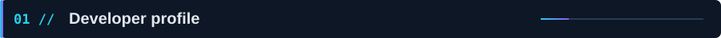</p>

Computer Engineering student at **Konya Technical University**, Türkiye. My focus is building full-stack applications with ASP.NET Core and React, alongside application security and penetration testing.

```text
$ whoami
  Focus      : Backend engineering · Full-stack development
  Building   : SocialFlow AI · Mini CRM
  Exploring  : Software architecture · Testing · DevSecOps
```

<p>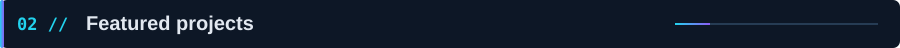</p>

<p align="center">
  <a href="https://github.com/frhandev/social-media-automation">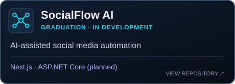</a>
  <a href="https://github.com/frhandev/mini-crm">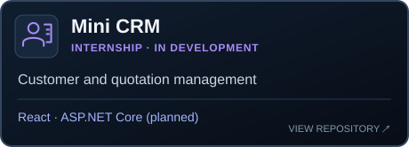</a>
</p>
<p align="center">
  <a href="https://github.com/frhandev/taskflow">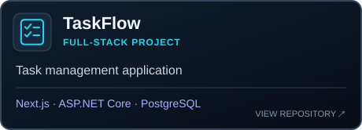</a>
  <a href="https://github.com/frhandev/iron-gym">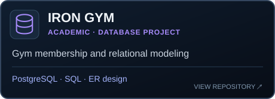</a>
</p>

<p>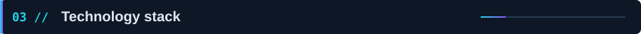</p>

**Backend** · C# / ASP.NET Core / EF Core / Node.js / Express


**Frontend** · React / Next.js / TypeScript / JavaScript / Tailwind CSS


**Data & engineering** · PostgreSQL / MongoDB / SQL Server / Docker / Git


**Security & tooling** · Linux / Kali Linux / Python / Burp Suite


<p>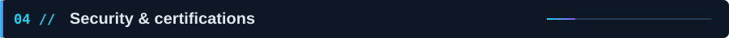</p>

<p align="center">
  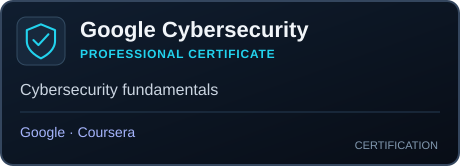
  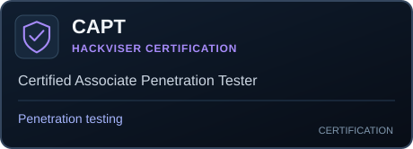
</p>
<p align="center">
  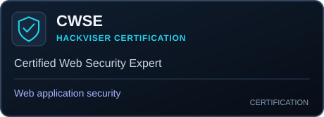
</p>

<p>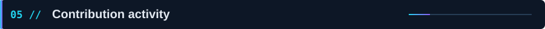</p>

<p align="center">
  <picture>
    <source media="(prefers-color-scheme: dark)" srcset="https://raw.githubusercontent.com/frhandev/frhandev/main/assets/contribution-dark.svg?v=2" />
    <source media="(prefers-color-scheme: light)" srcset="https://raw.githubusercontent.com/frhandev/frhandev/main/assets/contribution-light.svg?v=2" />
    
  </picture>
</p>

<p align="center"><a href="https://github.com/frhandev?tab=overview">View contribution history</a></p>

---

<p align="center"><strong>Build. Learn. Secure. Repeat.</strong></p>
