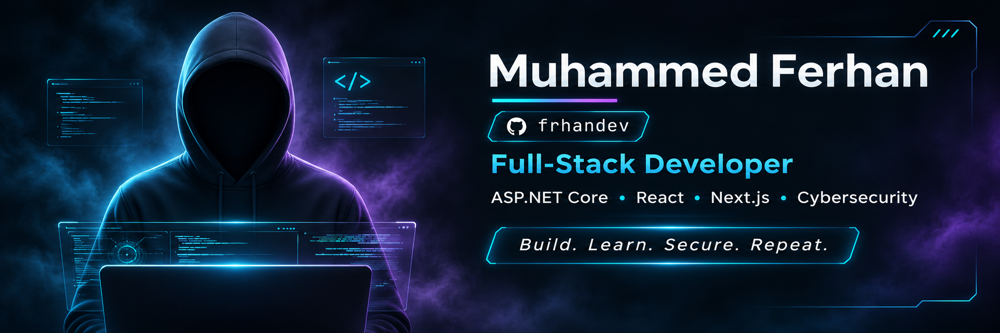

## 01 / About me

Computer Engineering student at **Konya Technical University**, Türkiye. I build full-stack applications using **ASP.NET Core, React and Next.js**, with a particular interest in backend engineering, application security and penetration testing.

- Graduation project: **SocialFlow AI** — AI-assisted social media management.
- Internship project: **Mini CRM** — customer and quotation management.
- Currently exploring software architecture, automated testing and DevSecOps.

## 02 / Selected projects

| Project | Focus | Stack / Status |
| :--- | :--- | :--- |
| [**SocialFlow AI**](https://github.com/frhandev/social-media-automation) | AI-assisted social media management | Next.js · ASP.NET Core planned · In development |
| [**Mini CRM**](https://github.com/frhandev/mini-crm) | Customer and quotation management | React · ASP.NET Core planned · In development |
| [**TaskFlow**](https://github.com/frhandev/taskflow) | Full-stack task management | Next.js · ASP.NET Core · PostgreSQL |
| [**IRON GYM**](https://github.com/frhandev/iron-gym) | Gym management and database engineering | PostgreSQL · ER modeling · Academic project |

## 03 / Technology stack

| Area | Technologies |
| :--- | :--- |
| Backend | C# · ASP.NET Core · EF Core · Node.js · Express |
| Frontend | React · Next.js · TypeScript · JavaScript · Tailwind CSS |
| Databases | PostgreSQL · MongoDB · SQL Server |
| Security & tooling | Linux · Kali Linux · Python · Burp Suite · Docker · Git |

## 04 / Security & certifications

- Google Cybersecurity Professional Certificate
- Certified Associate Penetration Tester (CAPT) — Hackviser
- Certified Web Security Expert (CWSE) — Hackviser

## 05 / GitHub activity

<picture><source media="(prefers-color-scheme: dark)" srcset="https://github-readme-stats.vercel.app/api?username=frhandev&show_icons=true&hide_border=true&bg_color=0D1726&title_color=22D3EE&text_color=E2E8F0&icon_color=A78BFA" /></picture>
<picture><source media="(prefers-color-scheme: dark)" srcset="https://github-readme-stats.vercel.app/api/top-langs/?username=frhandev&layout=compact&hide_border=true&bg_color=0D1726&title_color=22D3EE&text_color=E2E8F0" /></picture>

<picture><source media="(prefers-color-scheme: dark)" srcset="./assets/contribution-dark.svg"/></picture>

Statistics reflect available repository data, not proficiency ratings.

---

<strong>Build. Learn. Secure. Repeat.</strong>

